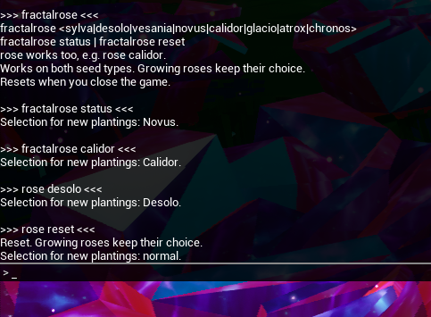

# 🌹 Fractal Rose Selector 🌹

Choose which Fractal Rose variant grows regardless of which planet you're on. Works with both fractal rose seeds and hybrid rose seeds.

Multiplayer tested.

## Installation

Vortex or AstroModLoader-Classic installation recommended.

[Please see detailed installation guide here.](https://yuexr.github.io/astro/mods/installation.html)

UE4SS (and UE4SS ConsoleCommandsMod) required.  
Both automatically installed through instructions above.

**Multiplayer:** Server-side mod. Only the host can select the variant.
Guest commands do not affect host selection but may create temporary visual bug on their screen; goes away after rejoining the game. It is recommended for guests to disable the mod if joining another player's world.

## Rose Variant Selection

Normal rose selection used by default.
Pick a variant using the in-game console to force the variant of new roses.

Press F10 once to open the console input field or twice to see the full console.

Available commands:
```
fractalrose
fractalrose <sylva|desolo|vesania|novus|calidor|glacio|atrox|chronos>
fractalrose status
fractalrose reset
```
`rose` works as an alias to `fractalrose`, e.g. `rose status`.

Examples:
- `fractalrose`: show help/commands.
- `fractalrose status`: show the current selection.
- `fractalrose calidor`: new seeds planted grow into the Calidor variant.
- `rose desolo`: new seeds planted grow into the Desolo variant.
- `rose reset`: reset to normal seed behaviour.



This mod applies to newly planted fractal rose and hybrid rose seeds only.
Changing the selection does not affect germinating seeds (mid-growth) or fully grown roses.
The selection resets when the game is closed.

