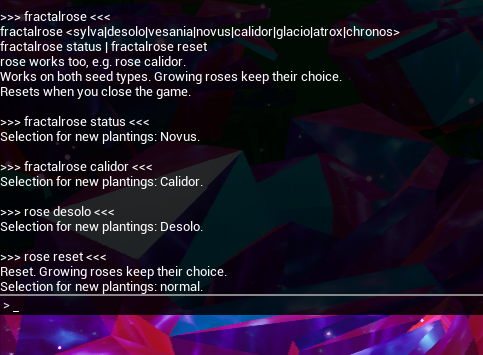

# 🌹 Fractal Rose Selector 1.0.0 🌹

Choose which Fractal Rose variant grows regardless of which planet you're on. Works with both fractal rose seeds and hybrid rose seeds.

## Install

- **(RECOMMENDED)** Install with [Nexus Mods Vortex](https://www.nexusmods.com/vortex), which automatically installs required extensions for Astroneer mods.
- Manual installation:
    1. Download the latest [UE4SS experimental .zip file](https://github.com/UE4SS-RE/RE-UE4SS/releases/tag/experimental-latest) (scroll to the bottom under assets).
    2. In Steam, right-click Astroneer → Manage → Browse local files. Open `Astro\Binaries\Win64`.
    3. Extract the UE4SS .zip content into `Astro\Binaries\Win64`.
    4. Extract the mod's zip `Fractal-Rose-Selector-#.#.#-UE4SS.zip` into `Astro\Binaries\Win64\ue4ss\Mods`.
    5. The folder structure should look something like this: `ASTRONEER\Astro\Binaries\Win64\ue4ss\Mods\FractalRoseSelector`.


## Rose Variant Selection

Normal rose selection used by default.
Pick a variant using the in-game console to force the variant of new roses.

Press F10 once to open the console input field or twice to see the full console.

Available commands:
```
fractalrose
fractalrose <sylva|desolo|vesania|novus|calidor|glacio|atrox|chronos>
fractalrose status
fractalrose reset
```
`rose` works as an alias to `fractalrose`, e.g. `rose status`.

Examples:
- `fractalrose`: show help/commands.
- `fractalrose status`: show the current selection.
- `fractalrose calidor`: new seeds planted grow into the Calidor variant.
- `rose desolo`: new seeds planted grow into the Desolo variant.
- `rose reset`: reset to normal seed behaviour.



This mod applies to newly planted fractal rose and hybrid rose seeds only.
Changing the selection does not affect germinating seeds (mid-growth) or fully grown roses.
The selection resets when the game is closed.

